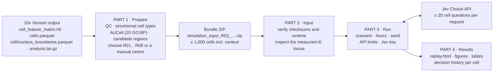
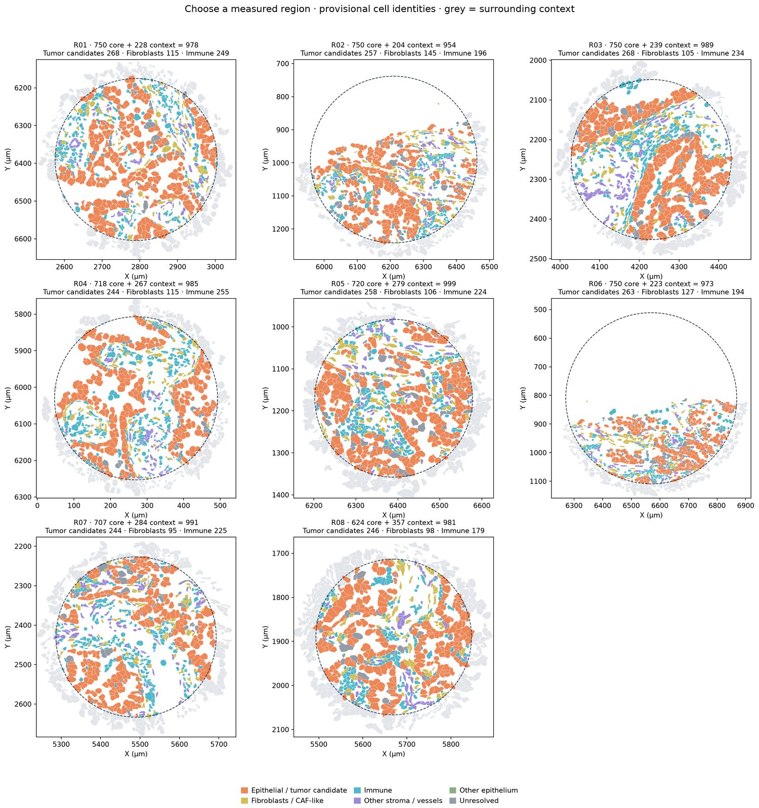

# VirtualTissue-Xenium

**An AI-agent-driven virtual tissue built from real 10x Genomics Xenium data.**

VirtualTissue-Xenium takes one region of a Xenium section (cell segmentation, XY coordinates and gene expression) and turns it into a living simulation in which **every cell is an agent**. Each cell starts from its own measured state at time zero: 20 AUCell pathway scores computed from its transcripts, its polygon and its measured contacts. Whenever something relevant happens to it, the cell asks **Jev** ([TypeSafe](https://typesafe.ai)'s model for structured choices) which of its currently permitted actions to take: crawl toward a tumour cell, degranulate, enter the cell cycle, phagocytose a corpse, secrete a signal, rest. A deterministic physics kernel owns everything that should not be left to a model: space, mechanics, diffusing fields, clocks, damage, death and division.

Use the same measured starting tissue to ask a specific question and compare a control with a changed assumption. The replay highlights recorded events and local signal peaks; you can click a cell and inspect every decision. Current experiments support declared immune recognition and its negative control. Named drugs, acquired resistance and neutrophil recruitment are not implemented. The [experiment design guide](docs/11_experiment_design.md) separates available experiments from the proposed perturbation workbench.


*Region R03 of the public 10x Xenium Prime 5K lung adenocarcinoma section: 989 measured cells, of which 526 act and 463 are context, coloured by provisional cell type. This frame comes from a software test with mocked Jev answers.*

---

## Contents

1. [The four parts](#1-the-four-parts)
2. [Quick start in Google Colab](#2-quick-start-in-google-colab)
3. [Quick start on your own computer](#3-quick-start-on-your-own-computer)
4. [How it works](#4-how-it-works)
5. [The worked example: public Xenium Prime 5K lung cancer](#5-the-worked-example-public-xenium-prime-5k-lung-cancer)
6. [Cost, limits and safety](#6-cost-limits-and-safety)
7. [Repository layout](#7-repository-layout)
8. [Validation status](#8-validation-status)
9. [Scope and limitations](#9-scope-and-limitations)
10. [Credits, data licence and citation](#10-credits-data-licence-and-citation)

Detailed guides are in [`docs/`](docs/README.md).

**Choose your starting point:**

| Your goal | Start here |
|---|---|
| Try the public Xenium Prime 5K example in your own Google Colab and Drive | [Colab quick start below](#2-quick-start-in-google-colab); no data upload or API key is needed for Part 1 |
| Prepare your own Xenium sample | [Own-data guide](docs/06_your_own_xenium_data.md): required files, Drive/local paths, a cluster-map example, validation and export |
| Run on your own computer | [Local quick start below](#3-quick-start-on-your-own-computer) and [Jupyter path settings](docs/08_local_installation.md#3-the-notebooks-in-local-jupyter) |
| Reopen an existing simulation | [Results guide](docs/04_part4_results.md); no API key needed |

**Before choosing your own data:** the current preparation workflow targets **human tumour tissue** with tumour-candidate epithelium, fibroblasts and immune cells. It needs a reviewed map of your sample's clusters to the supported cell types. Region proposals require at least 15% tumour candidates, 8% fibroblasts and 15% immune cells in the central area; a manual centre does not bypass a failed proposal step. Other tissues and species are not covered by this tutorial. See the [requirements and limitations](docs/06_your_own_xenium_data.md#1-what-your-data-must-look-like) before uploading files.

---

## 1. The four parts



| Part | Notebook | You provide | You get | Guide |
|---|---|---|---|---|
| **1 · Prepare** | [`Part1_Prepare_Xenium_Region.ipynb`](notebooks/Part1_Prepare_Xenium_Region.ipynb) | A Xenium output folder: the public example, which the notebook can download, or your own data | Candidate-region maps, AUCell scores and **one bundle ZIP per chosen region** | [docs/01](docs/01_part1_prepare_region.md) |
| **2 · Input** | [`Part2-4_Run_Jev_Simulation.ipynb`](notebooks/Part2-4_Run_Jev_Simulation.ipynb), Part 2 | The bundle ZIP: from Part 1, from your own data, or a shared one | A verified bundle and a map of the measured t0 tissue | [docs/02](docs/02_part2_input_bundle.md) |
| **3 · Run** | same notebook, Part 3 | Scenario, duration, seed, request limits and Jev API key | A run folder with a journal of every API exchange and checkpoints | [docs/03](docs/03_part3_run_simulation.md) |
| **4 · Results** | same notebook, Part 4, and [`Part4_Explore_Saved_Results.ipynb`](notebooks/Part4_Explore_Saved_Results.ipynb) | A results ZIP or run folder | Interactive replay, summary figures, decision tables and run comparisons | [docs/04](docs/04_part4_results.md) |

Each part can be run on its own. A bundle ZIP from Part 1 can be shared, and the same bundle can be simulated many times with different scenarios or seeds.

---

## 2. Quick start in Google Colab

Everything runs on a free **CPU** runtime. Inputs and results live in **your own Google Drive**, and the Jev key stays in **your own Colab Secrets**. A complete walk-through, including every path you may need to change, is in [docs/05_google_colab.md](docs/05_google_colab.md).

**One-time preparation**

1. Use your own Google account and Drive. For a paid simulation, get your own Jev API key from TypeSafe ([docs/07_jev_api_key.md](docs/07_jev_api_key.md)). You can complete Part 1 and a free local preview without a key.
2. *(Only if the repository is not public yet, or you changed the code.)* Upload the whole `VirtualTissue-Xenium` folder to `MyDrive/VirtualTissue-Xenium`. In each notebook's first cell, set `CODE_SOURCE = google_drive`.

**Part 1: prepare a region (about 5–10 minutes the first time)**

3. Open [colab.research.google.com](https://colab.research.google.com) and choose **File → Open notebook → GitHub**. Paste `hylixinsights/VirtualTissue-Xenium` and open `notebooks/Part1_Prepare_Xenium_Region.ipynb`. You can also upload the file from your computer.
4. Choose **Runtime → Change runtime type → Python 3, CPU**.
   Choose **File → Save a copy in Drive** to keep your notebook settings. If setup asks for a session restart, restart and rerun the setup cell before continuing.
5. Run the cells in order. In step 2 keep the defaults: `DATA_DIR = /content/drive/MyDrive/VirtualTissue/Xenium_Public_Lung5K`, with `DOWNLOAD_PUBLIC_EXAMPLE_IF_MISSING` checked. The ten original files (~503 MiB) are then downloaded from 10x Genomics into your Drive and verified.
6. Look at the region gallery (R01…R08). In **step 8**, set `REGION_TO_EXPORT` to the region you want, for example **`R03`**, and run the cell. The bundle ZIP is written to `MyDrive/VirtualTissue/Xenium_Lung5K_Prepared/run_<timestamp>/simulation_input_R03_<time>.zip`.

**Parts 2–4: simulate (minutes to hours, depending on duration and Jev latency)**

7. Open [`Part2-4_Run_Jev_Simulation.ipynb` in Colab](https://colab.research.google.com/github/hylixinsights/VirtualTissue-Xenium/blob/main/notebooks/Part2-4_Run_Jev_Simulation.ipynb) and save your own copy in Drive. **In this simulation notebook**, open the **🔑 Secrets** panel, click **Add new secret**, set Name = `TYPESAFE_API_KEY`, paste your key as the Value and switch on **Notebook access**. If the secret already exists, enable access for this notebook. Skip the secret for a local preview.
8. Run setup, then Part 2. `BUNDLE_ZIP` defaults to the Part 1 output folder, so the newest bundle inside it is used. To select a particular region or resume an earlier run, set it to that run's exact bundle ZIP. Keep this ZIP for future resumptions.
9. In Part 3, **explicitly choose `SCENARIO = declared_recognition` to test CD8-mediated tumour killing**. This assumes recognition and effector competence; it permits killing without guaranteeing it. The conservative default, `baseline_unknown`, leaves killing disabled. Set `HORIZON_HOURS` and `MAX_HTTP_ATTEMPTS`, then run the zero-cost **preflight**. Inspect the active CD8 count, growth headroom and first-round request estimate. Check **`START_RUN`** and run the cell.
10. In Part 4, the replay opens inside the notebook. The results are copied to `MyDrive/VirtualTissue/Simulation_Results/` and can also be downloaded as a ZIP. `replay.html` opens offline in any browser.

No API key yet? Set `RUN_MODE = "Local preview (no API)"`. The engine then runs the same simulation with programmed local rules, which are free and labelled as such everywhere.

**Using your own data in Colab:** run Part 1's setup cell, then pause and follow the [own-data guide](docs/06_your_own_xenium_data.md#2-step-1--create-the-data-folder). It mounts your Drive, prepares the five required files and helps you create and validate your cluster map. Return to Part 1 step 2 with your own paths and the public download unchecked. In Parts 2–4, select the ZIP you exported and give the experiment a new `RUN_NAME`.

---

## 3. Quick start on your own computer

You need Python **3.12 or 3.13**. Python 3.14 is not supported by the pinned scientific stack.

```bash
git clone https://github.com/hylixinsights/VirtualTissue-Xenium.git
cd VirtualTissue-Xenium
python3.13 -m venv .venv && source .venv/bin/activate
pip install -e ".[notebooks]"            # installs the exact validated versions

# Part 1: download the public example (~503 MiB) and export region R03
vtx download-example data/Xenium_Public_Lung5K
vtx prepare data/Xenium_Public_Lung5K outputs/prepared --region R03
BUNDLE=$(ls -t outputs/prepared/run_*/simulation_input_R03_*.zip | head -1)

# Part 2: inspect the immune-killing experiment before running it (no API calls)
vtx check "$BUNDLE" --scenario declared_recognition --hours 48

# Part 3: free local preview, then a real Jev run
vtx run "$BUNDLE" outputs/runs --run-name R03_decl_local --mode local \
        --scenario declared_recognition --hours 48 --seed 21
export TYPESAFE_API_KEY=...               # never commit it
vtx run "$BUNDLE" outputs/runs --run-name R03_decl01 --mode jev \
        --scenario declared_recognition --hours 48 --seed 21 --max-http-attempts 1000

# Part 4: summary, figure and replay
vtx explore outputs/runs/R03_decl01_results.zip --plot outputs/R03_decl01_overview.png --open
```

For a matched negative control, repeat the Jev command with `--scenario recognition_off` and a new name such as `R03_recognition_off01`, retaining every other setting. Only interpret the shared simulated time interval if either run stops at its request cap. `1000` is a ceiling on requests, not a guarantee of reaching 48 h. Keep `baseline_unknown` when the question is what happens without assuming immune recognition; elapsed time does not unlock killing. Hypoxic necrosis is a separate mechanism.

**Already prepared R08?** The same experiment uses your exact bundle path:

```bash
vtx run outputs/prepared/run_20261026_115727_254671/simulation_input_R08_115925_827152.zip outputs/runs \
  --run-name R08_decl01 --mode jev --scenario declared_recognition \
  --hours 48 --seed 21 --max-http-attempts 1000
```

Replace that path with your own exported ZIP. R08 in the public example has only three active CD8 cells; a small response can reflect composition, contacts, choices or model assumptions. Inspect these before extending the horizon. R03 and R08 also start near the default 1,000-body ceiling; use the same larger `--max-population` in both arms if growth is part of the question.

The same notebooks also run in local Jupyter (`jupyter lab notebooks/`). They detect local execution for code loading and working folders, but **you must replace the Drive paths in the input/output fields before running the data cells**. Set Part 1's `DATA_DIR` and `OUTPUT_BASE`, Part 2's `BUNDLE_ZIP`, and the explorer's `RESULTS_PATH` to your own local paths. Uncheck `SAVE_RESULTS_TO_DRIVE`, or set its destination to a local backup folder. The [local guide](docs/08_local_installation.md#3-the-notebooks-in-local-jupyter) lists every field. For your own sample, follow the [own-data guide](docs/06_your_own_xenium_data.md) before `vtx prepare`.

---

## 4. How it works

### 4.1 Three layers with strict responsibilities

| Layer | Owns | Never does |
|---|---|---|
| **Kernel** (`xenium_runtime/`) | Geometry and contacts, mechanics, diffusing fields, cell-cycle clocks, damage, death, division, clearance, audit | Ask a model whether a cell dies, divides, or what it is |
| **Contract** (`runtime_contract.json` inside each bundle) | Which actions exist, which cell types may take them, which conditions gate them, every numerical assumption and scenario | Travel to the model, or contain expression data |
| **Jev** | Ranks the actions the kernel has already allowed for this cell and returns a probability for each | Supply a rate, a concentration, a duration, an identity or a fate |

### 4.2 From Xenium to agents (Part 1)

1. **Load and audit.** The sparse count matrix (Gene Expression features only), cell table and polygons are loaded. Every file is checked against its SHA-256, and every table is joined by the original Xenium cell ID.
2. **Provisional identities.** Each of the 10x graph-based clusters is mapped to a label, a compartment and a *runtime label*, the type that decides in the simulation. The packaged map covers the 32 clusters of the public sample. For your own sample, you write this map yourself ([docs/06](docs/06_your_own_xenium_data.md)).
3. **AUCell, not genes.** A Xenium cell has few detected transcripts, so most zeros are technical. Each cell is therefore described by **20 GO:BP AUCell scores** (decoupler 2.3.0, MSigDB 2026.1, top-100 ranks over the whole panel), given as percentiles **within its provisional type and RNA-depth decile**, with the whole section as the reference. Missing evidence stays missing.
4. **Regions.** Discs of ≤ 1,000 cells, made of about 750 central cells plus a 30 µm context halo, are proposed where tumour-candidate epithelium, fibroblasts and immune cells mix. You pick one by name (`R03`), or by giving a centre.
5. **Export.** The bundle holds `atlas.json.gz` (one record per cell: polygon, contacts at polygon distance ≤ 1 µm, identity and t0 AUCell), `runtime_contract.json`, `region.h5ad` (raw counts and XY), the original boundaries, provenance and a checksum manifest.

### 4.3 How one cell asks Jev (Part 3)

The kernel advances in **10-minute ticks**. A cell is asked only when something relevant happens to it: a new heterotypic contact, a field crossing a threshold, a finished program, a cell-cycle checkpoint, or entry into the region. Each type has a minimum interval between questions (CD8 60 min, or 30 min while touching tumour; CD4 and macrophages 180 min; endothelium 360 min; tumour and fibroblasts 720 min), and a cell is asked at most 24 times per simulated day. Cells that need a decision in the same tick are batched into one `POST https://api.typesafe.ai/v1/systemone` (at most 20 questions or 40 KB per request).

This is a real question from the first round of region R03, slightly shortened:

```json
{
  "model": "jev-1.14.0",
  "state": {"setting": "Independent local cells in an uncalibrated LUAD virtual tissue prototype.",
            "semantics": "AUCell relative expression scores at t0, conditioned on provisional type and detection depth; unavailable evidence is missing. Scores are not protein activity or validated malignancy. SIM fields and rates are assumptions."},
  "questions": {
    "c11869": {
      "type": "choice",
      "instructions": {
        "task": "Choose one permitted local behavior for this cell.",
        "local_observation": {
          "time_min": 0, "primary_label": "Tumor",
          "t0_aucell_percentile": {"MITOTIC_CELL_CYCLE": 0.84, "EXTRACELLULAR_MATRIX_DISASSEMBLY": 0.86,
                                   "EPITHELIAL_TO_MESENCHYMAL_TRANSITION": 0.69, "...": "20 signatures"},
          "t0_aucell_raw": {"MITOTIC_CELL_CYCLE": 0.097, "...": "..."},
          "sim_state": {"viability": "alive", "damage_au": 0.0, "pdl1": 0.0, "glycolysis": 0.25},
          "fields_sim": {"oxygen": 0.62, "glucose": 0.53, "lactate": 0.15, "ifng": 0.0, "cxcl9": 0.0},
          "contacts": {"columns": ["id", "primary_label", "viability_sim", "pdl1_sim", "provenance"],
                       "rows": [[11871, "Tumor", "alive", 0.0, "measured_contact_persisting"], ["...", "4 contacts"]]},
          "recognition_sim": null,
          "excluded": {"UPREGULATE_PDL1": ["ifng_signal:false"], "SECRETE_VEGFA": ["hypoxia_or_declared_nerve:false"]}
        }
      },
      "criteria": {
        "REMAIN_QUIESCENT": "Remain out of cycle until the next checkpoint.",
        "ENTER_CYCLE": "Start the accelerated SIM cycle; the kernel checks space again at division."
      }
    }
  }
}
```

The request **never contains** raw expression, gene lists, coordinates, the contract, literature or a desired outcome. The `excluded` block records which actions were not offered and why. Jev returns a `choice`, a probability for **every** offered option and a `confidence`.

### 4.4 What the kernel does with the answers

Before anything changes, every answer in a round is validated. The returned model must be the pinned one, the option keys must match the menu exactly, the probabilities must lie in [0, 1] and sum to 1 within the rounding tolerance, and the choice must be the argmax. A malformed answer, an API error or model drift **stops the run cleanly**. There is no silent fallback. Each request is written to `jev_journal.jsonl` **before** it is sent, and each response is written before it is applied. The key is never written. Valid choices then start timed programs that the kernel executes:

| Process | Implementation (declared assumptions, uncalibrated) |
|---|---|
| Space | Power-diagram cells with measured area floors; movement and growth push neighbours |
| Fields | Oxygen and glucose from vessels; lactate, IFN-γ-like, CXCL9/10-like, VEGF-like, TGF-β-like and matrix on a grid |
| Killing | `DEGRANULATE` is a 20-minute contact program that deals 1 damage unit. At 2 units the target commits to apoptosis. Killing is licensed only in `declared_recognition` |
| Division | `ENTER_CYCLE` starts an explicitly accelerated 24 h cycle; growth and division pause when there is no room |
| Corpses | Apoptotic cells emit a find-me signal (120 µm). `EFFEROCYTOSE` removes a corpse in 40 min (capacity 4) |

The menus per cell type are listed in [docs/06](docs/06_your_own_xenium_data.md#5-runtime-labels-and-what-each-type-can-do).

---

## 5. The worked example: public Xenium Prime 5K lung cancer

| | |
|---|---|
| Dataset | *Xenium Prime Human Lung Cancer FFPE*, experiment 2 · [10x Genomics](https://www.10xgenomics.com/datasets/xenium-human-lung-cancer-post-xenium-technote) · CC BY 4.0 |
| Tissue and panel | Invasive acinar lung adenocarcinoma, FFPE · Xenium Prime 5K Human Pan Tissue and Pathways (5,001 genes) · XOA 3.0.0 |
| Cells | 278,328 total · 271,693 pass RNA QC · 217,922 receive AUCell scores (≥ 100 detected genes) |
| Files used | 10 of the 22.6 GB archive: 526,970,800 bytes (~503 MiB), listed with SHA-256 in [`datasets/xenium_prime_lung5k`](src/virtualtissue_xenium/datasets/xenium_prime_lung5k/) |

Part 1 proposes eight regions with the default settings:



| Region | Central + context = total | Tumour candidates | Fibroblasts | Immune | CD8 (provisional) | Macrophages (provisional) |
|---|---|---|---|---|---|---|
| R01 | 750 + 228 = 978 | 268 | 115 | 249 | 4 | 3 |
| R02 | 750 + 204 = 954 | 257 | 145 | 196 | 5 | 7 |
| **R03** | **750 + 239 = 989** | **268** | **105** | **234** | **3** | **12** |
| R04 | 718 + 267 = 985 | 244 | 115 | 255 | 6 | 54 |
| R05 | 720 + 279 = 999 | 258 | 106 | 224 | 4 | 7 |
| R06 | 750 + 223 = 973 | 263 | 127 | 194 | 4 | 15 |
| R07 | 707 + 284 = 991 | 244 | 95 | 225 | 6 | 10 |
| R08 | 624 + 357 = 981 | 246 | 98 | 179 | 8 | 18 |

**R03** exported in `exploratory_candidates` mode has 989 cells: **526 act** and 463 are context. The acting cells are 263 tumour candidates, 95 CAFs, 71 CD4 T cells, 36 plasma cells, 33 endothelial cells, 10 macrophages, 9 fibroblasts, 7 B cells and **only 2 CD8 T cells**. B and plasma cells have no action menu. The first decision round asks **280 questions in 26 HTTP requests**. With the default population ceiling (1,000 bodies), only 11 new cells can be born. Raise `MAX_POPULATION` to study growth. R04 has many more macrophages, if clearance is your question.

---

## 6. Cost, limits and safety

* **You control spending with `MAX_HTTP_ATTEMPTS`.** It is a hard cap on POST requests, including failed ones, and it holds across resumptions. If the next complete round does not fit, the run stops *before* sending it and still saves a valid replay. It is a request cap, not a dollar cap. Check TypeSafe's pricing for your account.
* `MAX_CELL_DECISIONS` caps individual cell questions. `HORIZON_HOURS` caps simulated time.
* **Resuming reuses answers preserved in the journal.** Keep the same input ZIP, `RUN_NAME`, settings and software environment. In Colab, `SAVE_RESULTS_TO_DRIVE` refreshes the copy after each completed simulated hour and at the end. If the runtime is lost, paid answers since the last successful backup may be lost and requested again; before the first backup, there may be no run to restore. Backup failures can make this gap longer. A failed or unresolved request that is present in the recovered journal is never re-sent automatically. See [recovery and its limits](docs/05_google_colab.md#7-when-colab-disconnects).
* **Keys.** Read from Colab Secrets (`TYPESAFE_API_KEY` or `JEV_API_KEY`), from an environment variable, or from a hidden prompt. A key is never stored in a notebook, journal, replay or result, and the tests check this.
* **Data ZIPs are never executed.** The simulator compares every Python file in a bundle with its own engine by SHA-256 and imports only its own code.

---

## 7. Repository layout

```text
VirtualTissue-Xenium/
├── README.md                     this file
├── docs/                         detailed guides (start at docs/README.md)
├── notebooks/                    the three Colab/Jupyter notebooks (generated by tools/build_notebooks.py)
├── src/virtualtissue_xenium/
│   ├── __init__.py               puts engine/ on sys.path; lazy access: vtx.prepare, vtx.workflow, vtx.runtime
│   ├── engine/                   ◀ the biological kernel plus replay (hashes and revisions in ORIGINAL_SOURCES.json)
│   │   ├── xenium_prepare.py         Part 1: load, annotate, AUCell, regions, export
│   │   ├── prepared_runtime.py       bundle loader and static validation (also embedded in every bundle)
│   │   ├── simulation_workflow.py    Parts 2–4: extract, preflight, run, checkpoints, results ZIP
│   │   ├── jev_provider.py           Jev Choice API client with journal and hard request cap
│   │   ├── player.py + web/          interactive replay (single offline HTML file)
│   │   ├── xenium_runtime/           the kernel (mechanics, fields, menus, scheduler, episode)
│   │   ├── resources/                cluster map of the public sample, 20 GO:BP gene sets, runtime template
│   │   ├── colab_setup*.py           Python check, pinned install, restart detection
│   │   └── requirements-colab.txt    exact validated versions (also embedded in every bundle)
│   ├── download.py               download the public example by byte ranges, verify, register manual downloads
│   ├── own_data.py               your own Xenium run: data folder, manifest, cluster-map template and validation
│   ├── colab.py                  Drive mount, key lookup, Drive backup/restore of runs, inline replay
│   ├── results.py                Part 4 analysis helpers (summary, populations, decisions, comparisons)
│   ├── cli.py                    the `vtx` command line
│   └── datasets/xenium_prime_lung5k/   SOURCE, DOWNLOAD_MANIFEST and checksums of the public example (no data)
├── tests/                        unit tests, original engine tests, mocked notebook execution
└── tools/build_notebooks.py      regenerates notebooks/ from readable source
```

Why the biological kernel is vendored and placed on `sys.path` is explained in [docs/09_architecture.md](docs/09_architecture.md). In short, bundles embed `prepared_runtime.py` and `xenium_runtime/`, and the simulator refuses a bundle whose code differs by even one byte.

---

## 8. Validation status

| Check | Result |
|---|---|
| Engine files match the recorded version; biological runtime remains unchanged | ✔ SHA-256 of all 32 files ([`ORIGINAL_SOURCES.json`](src/virtualtissue_xenium/engine/ORIGINAL_SOURCES.json)), enforced by `tests/test_engine_integrity.py` |
| Part 1 through the package reproduces the earlier R03 export | ✔ all 39 bundle files byte-identical, including `region.h5ad` and the atlas fingerprint `67f4eb78…` |
| Own-data route (fresh manifest, filled-in cluster template) | ✔ same 989 R03 cells as the public route; only sample ID and provenance differ |
| Original engine tests (Jev provider, preparation, R03 integration with mocked Jev) | ✔ budget stop before a round, atomic failed rounds, deterministic resume, rejection of unsafe or modified ZIPs. Run on Python 3.12 and 3.13 |
| 24 h simulation of R03 through the package (`vtx run --mode local`) | ✔ same decisions and events as the original 24 h validation: 761 decisions, 11 divisions, 65 divisions blocked by the population ceiling |
| All three notebooks executed end to end (mocked Colab UI and Jev) | ✔ Part 1 → R03 ZIP; Parts 2–4 with mocked Jev; Drive restore in a "new runtime" sent **0** new requests; upload + local preview; explorer |
| API key absent from every output | ✔ checked across journals, replays, CSVs and ZIPs |
| Live Jev result artifacts supplied by users | R03 (24 h) and R08 (72 h) saved replays inspected; both used `baseline_unknown`. Further samples and technologies remain unvalidated |

Run the tests with `pytest`. See [docs/08](docs/08_local_installation.md#5-running-the-tests) for the full and mocked notebook checks.

---

## 9. Scope and limitations

* This is an **uncalibrated mechanism simulation**, not a patient prediction. Measured t0 RNA scores inform local choices. Fields, rates, cycle length (an explicitly accelerated 24 h), recognition and effector competence are declared assumptions.
* Cell identities are **provisional** interpretations of vendor clusters. "Tumour candidate" does not establish malignancy. In this panel *SPP1* is absent, so macrophages form one generic class.
* AUCell scores are relative RNA-enrichment ranks within type and depth. They are not protein activity, and percentiles are not comparable across types.
* Jev's probabilities rank the behaviours offered at that moment. They are not reaction rates.
* Part 1 was written for Xenium Onboard Analysis outputs (validated on XOA 3.0 / Prime 5K) and for tumour tissue: automatic region proposals require tumour-candidate epithelium. Other panels work if their files follow the same format, but some provenance strings name the 5,001-gene panel. See [docs/06](docs/06_your_own_xenium_data.md#6-known-limitations).
* Exact floating-point trajectories can differ between CPU architectures (for example Apple silicon and Colab's x86-64). The decision and event counts of the mocked tests matched across machines, but a run started on one machine cannot be resumed on another.

---

## 10. Credits, data licence and citation

* Concept and design: **Helder Nakaya** (Computational Systems Biology Laboratory, University of São Paulo; Hospital Israelita Albert Einstein), with AI assistance in implementation.
* Cell decisions: **Jev** by [TypeSafe](https://typesafe.ai) ([System One API](https://docs.typesafe.ai/api/system-one), [Choice](https://docs.typesafe.ai/primitives/choice), [models](https://docs.typesafe.ai/models)).
* Example data: 10x Genomics, *Post-Xenium Technical Note: Xenium v1 and Xenium Prime 5K for FFPE Human Lung Cancer*, experiment 2 (2024), [CC BY 4.0](https://creativecommons.org/licenses/by/4.0/). The data are **not** redistributed in this repository. Keep this attribution when you share bundles derived from them.
* Gene sets: MSigDB C5:GO:BP 2026.1.Hs (20 processes) · AUCell: Aibar et al., *Nat Methods* 2017, via [decoupler](https://decoupler.scverse.org).
* Sibling projects: [VirtualTissue](https://github.com/hylixinsights/VirtualTissue) (gut), [VirtualTissue-LN](https://github.com/hylixinsights/VirtualTissue-LN) (lymph node), [VirtualTissue-LUAD](https://github.com/hylixinsights/VirtualTissue-LUAD) (LUAD rulebook).

Software licence: [MIT](LICENSE). How to cite this software is described in [`CITATION.cff`](CITATION.cff).
