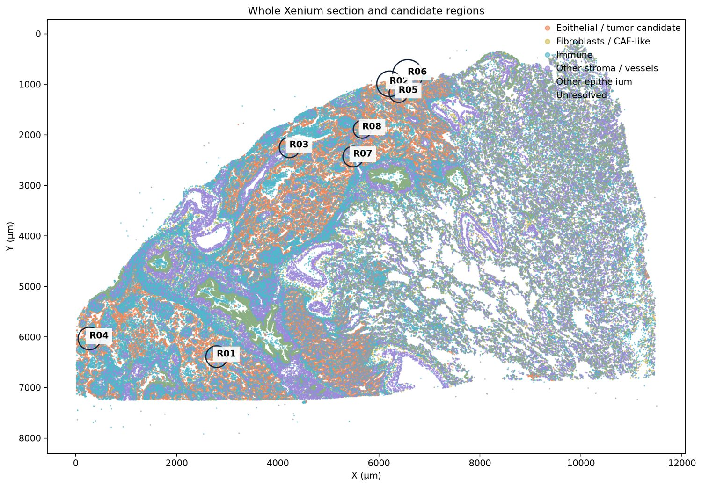

# Part 1 · Prepare a region from Xenium data

**Notebook:** [`notebooks/Part1_Prepare_Xenium_Region.ipynb`](../notebooks/Part1_Prepare_Xenium_Region.ipynb)
**Command line:** `vtx prepare DATA_DIR OUTPUT_BASE --region R03`
**Engine module:** `xenium_prepare.py` (unchanged original, version `lung5k-preparation-1.1.0`)

Part 1 reads an original Xenium output, describes every cell by 20 AUCell pathway scores, proposes regions of at most 1,000 cells and exports the region you choose as a **bundle ZIP**, the only input of Parts 2–4.

```text
DATA_DIR (raw Xenium files) ──► QC ──► provisional cell types ──► AUCell (whole section)
        ──► polygons ──► candidate regions R01…R08 ──► you choose ──► simulation_input_R03_<time>.zip
```

---

## 1. Get the input data

Part 1 needs a **data folder** (`DATA_DIR`) with this exact layout:

```text
Xenium_Public_Lung5K/                 ◀ DATA_DIR points here (not to raw/)
├── SOURCE.json                       where the data came from (sample, URL, licence)
├── DOWNLOAD_MANIFEST.json            size + SHA-256 of every file in raw/  ("complete": true)
└── raw/
    ├── cell_feature_matrix.h5        required · sparse counts (10x HDF5)
    ├── cells.parquet                 required · cell IDs, XY centroids (µm), counts, cell/nucleus areas
    ├── cell_boundaries.parquet       required · simplified cell polygons
    ├── nucleus_boundaries.parquet    required · simplified nucleus polygons
    ├── analysis.tar.gz               required · 10x graph-based clusters + differential expression
    ├── cells.zarr.zip                provenance · full segmentation masks (not used for geometry)
    ├── experiment.xenium             provenance
    ├── gene_panel.json               provenance
    ├── metrics_summary.csv           provenance
    └── analysis_summary.html         provenance
```

Every file listed in the manifest must be present and unchanged. Part 1 verifies sizes, and with `VERIFY_INPUT_HASHES` also SHA-256, before it reads anything.

### Option A · Let the notebook download the public example (recommended)

Keep `DOWNLOAD_PUBLIC_EXAMPLE_IF_MISSING` checked in step 2. If `DATA_DIR` has no `DOWNLOAD_MANIFEST.json`, the notebook calls `download_public_lung5k(DATA_DIR)`, which:

1. opens the official 10x archive
   `https://s3-us-west-2.amazonaws.com/10x.files/samples/xenium/3.0.0/Xenium_Prime_Human_Lung_Cancer_FFPE/Xenium_Prime_Human_Lung_Cancer_FFPE_outs.zip`
   (22.6 GB) **without downloading it whole**: it reads the ZIP directory and transfers only the ten members above (526,970,800 bytes ≈ 503 MiB) with HTTP byte-range requests;
2. checks each member's CRC32 and SHA-256 against the values recorded when the example was first prepared ([`datasets/xenium_prime_lung5k/DOWNLOAD_MANIFEST.json`](../src/virtualtissue_xenium/datasets/xenium_prime_lung5k/DOWNLOAD_MANIFEST.json));
3. writes `SOURCE.json` and `DOWNLOAD_MANIFEST.json` last, so an interrupted download is never mistaken for a complete one. If you rerun it, files that are already verified are kept.

The same from Python or the shell:

```python
from virtualtissue_xenium.download import download_public_lung5k
download_public_lung5k("/content/drive/MyDrive/VirtualTissue/Xenium_Public_Lung5K")
```
```bash
vtx download-example data/Xenium_Public_Lung5K
```

### Option B · Download the full archive yourself

1. On the [dataset page](https://www.10xgenomics.com/datasets/xenium-human-lung-cancer-post-xenium-technote), download the **Xenium Output Bundle** for experiment 2 (`Xenium_Prime_Human_Lung_Cancer_FFPE_outs.zip`, 22.6 GB).
2. Extract only the ten files into `DATA_DIR/raw/`:
   ```bash
   unzip Xenium_Prime_Human_Lung_Cancer_FFPE_outs.zip cell_feature_matrix.h5 cells.parquet cell_boundaries.parquet \
         nucleus_boundaries.parquet analysis.tar.gz cells.zarr.zip experiment.xenium gene_panel.json \
         metrics_summary.csv analysis_summary.html -d data/Xenium_Public_Lung5K/raw
   ```
3. Register and verify them: `vtx register-download data/Xenium_Public_Lung5K`, or in Python `virtualtissue_xenium.download.register_manual_download(DATA_DIR)`.

### Option C · Your own Xenium run

First check the [own-data requirements](06_your_own_xenium_data.md#1-what-your-data-must-look-like): the current workflow targets human tumour tissue and requires a suitable mixture of tumour candidates, fibroblasts and immune cells. Run notebook setup, then **pause before step 2** and follow [06_your_own_xenium_data.md](06_your_own_xenium_data.md). It mounts Drive (or defines local paths), creates the data folder, and walks through editing and validating your **cluster annotation map**. Copy its four printed settings into step 2, including unchecking the public download.

---

## 2. Run the notebook, cell by cell

The **✏️** marks every value you may change.

| Step | Cell | What it does | ✏️ What you may change |
|---|---|---|---|
| 1 | *Get the code…* | Gets the code (GitHub or Drive), checks Python 3.12/3.13, installs the pinned packages, detects whether a restart is needed | `CODE_SOURCE` (only if not using GitHub) |
| 2 | *Data and output folders* | Mounts Drive, downloads the public example if needed, checks that all files are present, refuses a non-example sample without its own cluster map | **`DATA_DIR`**, **`OUTPUT_BASE`**, `DOWNLOAD_PUBLIC_EXAMPLE_IF_MISSING`, `CLUSTER_ANNOTATIONS_JSON` |
| 3 | *Parameters, integrity check…* | Creates `OUTPUT_BASE/run_<UTC timestamp>/`, verifies SHA-256, loads 278,328 cells × 5,001 genes, applies RNA QC (≥ 20 counts, ≥ 10 genes) | `MAX_TOTAL_CELLS`, `CORE_TARGET`, `HALO_UM`, `N_REGIONS`, `AUCELL_TOP_RANKS`, `VERIFY_INPUT_HASHES` |
| 4 | *Editable annotations…* | Maps the 10x clusters to provisional types and shows the marker-detection heat map | `ANNOTATION_OVERRIDES` |
| 5 | *Calculate AUCell…* | 20 AUCell scores for every eligible cell of the whole section, plus per-type and per-depth reference distributions | — |
| 6 | *Read segmentation and propose regions* / *Region gallery* | Reads the polygons and proposes up to `N_REGIONS` balanced regions, shown on the whole-section map and in a gallery | — |
| 7 | *Browse regions* (optional) | Dropdown to enlarge any region; **manual centre** (X, Y in µm) → region `MANUAL` | X/Y in the widget |
| 8 | *Export the chosen region* | Exports, checks one static 10-minute step, writes the manifest and **the ZIP** | **`REGION_TO_EXPORT`**, `TUMOR_MODE` |
| — | *Optional download* | Also downloads the ZIP to your computer | `DOWNLOAD_ZIP` |

### Parameters (step 3)

| Parameter | Default | Meaning | Allowed |
|---|---|---|---|
| `MAX_TOTAL_CELLS` | 1000 | Hard limit on all cells in the bundle, **including the context halo** | 100 – 1000 |
| `CORE_TARGET` | 750 | Target number of central cells; reduced automatically if the halo would exceed the limit | 100 – `MAX_TOTAL_CELLS` |
| `HALO_UM` | 30 | Width of the context ring, by polygon distance | ≥ 30 |
| `N_REGIONS` | 8 | How many proposals to show | 1 – 12 |
| `AUCELL_TOP_RANKS` | 100 | AUCell `n_up`: top-ranked genes per cell (≈ 2 % of a 5K panel). Cells with fewer detected genes keep missing scores | 2 – (panel size − 1) |
| `VERIFY_INPUT_HASHES` | True | Recompute SHA-256 of every raw file (~1 min for 503 MiB) | — |

Region-size changes take effect at step 6. Every later cell must be rerun.

### Reviewing annotations (step 4)

The 10x graph-based clusters are interpreted by the packaged map `engine/resources/cluster_annotations.json`, which covers the 32 clusters of the public sample. Each cluster has a display `label`, a `compartment` (`tumor_candidate`, `fibroblast`, `immune`, `stroma`, `epithelial_other`, `unknown`) and a `runtime_label`, the type that acts in the simulation, or `null` for context. To change a cluster for this session only:

```python
ANNOTATION_OVERRIDES = {14: {"label": "Unresolved", "compartment": "unknown", "runtime_label": None}}
```

Then rerun step 4 **and every following step**. Scores, references and regions depend on the annotation, and export refuses stale results.

### AUCell (step 5)

* Implementation: `decoupler.mt.aucell` 2.3.0, with the version enforced. The input is the original counts, with control probes and codewords excluded.
* Gene sets: 20 GO:BP processes from MSigDB 2026.1.Hs ([`resources/go20_msigdb_2026.1.Hs.json`](../src/virtualtissue_xenium/engine/resources/go20_msigdb_2026.1.Hs.json)). A signature is used if at least 5 of its genes are in the panel. Coverage is shown and saved in `signature_coverage.csv`.
* Each cell receives the raw AUCell score, its percentile within the provisional type, and its percentile within type × RNA-detection-depth decile. The last one is what simulated cells see. Reference groups need ≥ 20 cells per type and ≥ 30 per depth decile. Smaller groups, constant signatures and low-depth cells stay **missing**, never zero.
* Public example: 217,922 cells scored, 60,406 unscored. Runtime is a few minutes on 2 CPU cores.

### Region proposals (step 6)

* Grid centres every 180 µm are taken over tumour-candidate epithelium. Discs around them are kept if the central area has ≥ 15 % tumour candidates, ≥ 8 % fibroblasts and ≥ 15 % immune cells, and ≥ 80 % RNA-QC pass. Ranking favours ≈ 35 % / 20 % / 30 % plus ≈ 10 % other stroma. Two proposals may share at most 30 % of their central cells (Jaccard).
* Proposals are named **R01, R02, …** by decreasing balance score. Regions containing unusable polygons are rejected rather than repaired silently (the public example has 131 repaired and 122 unhandled outlines, recorded in `geometry_audit.json`).
* Everything inside the disc is kept, including unclassified and low-RNA cells, which become context.



### Choosing and exporting a region (steps 7–8)

1. Compare the regions in the gallery and in the table: composition, number of provisional CD8 T cells and macrophages, and the fraction with AUCell. "Immune" does not mean CD8. In the example, R03 has 234 immune cells but only 3 provisional CD8 T cells.
2. Optional: in step 7, enter a centre in µm (read it from the whole-section map) and click **Preview manual region**. That creates `MANUAL`.
3. In step 8, set **`REGION_TO_EXPORT = "R03"`** (any listed ID, or `MANUAL`) and run the cell. To export another region, change the value and run step 8 again. Each export goes to its own folder.

**`TUMOR_MODE`**

| Value | Effect |
|---|---|
| `exploratory_candidates` (default) | Tumour-candidate epithelium acts with runtime label `Tumor`. The assumption is recorded in the bundle (`provenance.tumor_mode`). |
| `context_until_review` | The same cells stay as context (`context_reasons = tumour_identity_not_confirmed`) until a pathologist or CNV analysis confirms malignancy. |

Cells become **context** instead of actors when RNA QC fails, when they carry conflicting lineage markers (`mixed_lineage_markers`), when they have no supported runtime label, or when tumour mode excludes them. Each cell lists its reasons in `annotation.context_reasons`.

---

## 3. What Part 1 writes

Everything goes to `OUTPUT_BASE/run_<UTC timestamp>/`. The input folder is never modified.

| File | Content |
|---|---|
| `input_audit.json` | Cells, genes, QC parameters, excluded feature types, SHA-256 of every input |
| `environment.json` | Python and package versions used |
| `annotation_review.csv`, `annotation_marker_review.png` | Cluster interpretation evidence |
| `signature_coverage.csv`, `aucell_provenance.json`, `score_calibration.json` | Gene-set coverage, AUCell settings, reference quantiles per type |
| `whole_sample_aucell.npz`, `whole_sample_annotations.parquet` | Scores, percentiles and annotations of **all** cells (reusable for other analyses) |
| `rna_depth_qc.png` | Detected genes per cell and the AUCell eligibility threshold |
| `candidate_regions.csv`, `candidate_regions.png`, `whole_section_regions.png`, `region_selection_rules.json` | The proposals and the rules used to make them |
| `geometry_audit.json` | Polygon repairs and unusable outlines |
| **`simulation_input_<ID>_<HHMMSS_ffffff>/`** and **`.zip`** | The bundle: unpacked, and compressed for Part 2 |

The bundle's contents are documented in [02_part2_input_bundle.md](02_part2_input_bundle.md).

---

## 4. Time and resources

| | Public example on Colab CPU |
|---|---|
| Download (Option A) | a few minutes, once (≈ 503 MiB) |
| Load + SHA-256 | ≈ 1 min |
| AUCell on 217,922 cells | ≈ 2–4 min |
| Regions + export R03 | < 1 min |
| Peak memory | ≈ 4 GB (fits the standard Colab runtime) |
| Bundle ZIP size | ≈ 20 MB |

---

## 5. Command-line equivalent

```bash
vtx prepare DATA_DIR OUTPUT_BASE --list-only                 # propose regions, save maps, export nothing
vtx prepare DATA_DIR OUTPUT_BASE --region R03                # export R03
vtx prepare DATA_DIR OUTPUT_BASE --region R01 --region R03   # several regions in one run
vtx prepare DATA_DIR OUTPUT_BASE --center 4230 2250          # manual centre (µm) → MANUAL
vtx prepare DATA_DIR OUTPUT_BASE --region R03 --tumor-mode context_until_review
vtx prepare MY_DATA OUTPUT_BASE --annotations my_clusters.json --region R01   # your own sample
```

Other options: `--core-target`, `--max-total`, `--halo`, `--n-regions`, `--aucell-top-ranks` and `--no-verify-hashes`. AUCell is recomputed on every call, which takes a few minutes. Use `--region` several times to avoid repeating it.

## 6. Python equivalent

```python
import virtualtissue_xenium as vtx
from prepared_runtime import validate_bundle
prep = vtx.prepare

sample = prep.load_sample(DATA_DIR, RUN_DIR, verify_hashes=True, min_counts=20, min_genes=10)
prep.annotate(sample, {})
prep.score_aucell(sample, n_up=100, min_overlap=5, batch_size=4096)
prep.read_geometry(sample)
table = prep.propose_regions(sample, n_options=8, core_target=750, max_total=1000, halo_um=30)
bundle = prep.export_region(sample, "R03", tumor_mode="exploratory_candidates",
                            destination=RUN_DIR / "simulation_input_R03_custom")
validate_bundle(bundle, smoke_steps=1)
prep.write_bundle_manifest(bundle)
zip_path = prep.zip_bundle(bundle)
```

**Reproducibility check:** with the public example and default settings, the package reproduces the R03 bundle exported by the original notebook byte for byte (39/39 files, atlas fingerprint `67f4eb7877f9…`).
