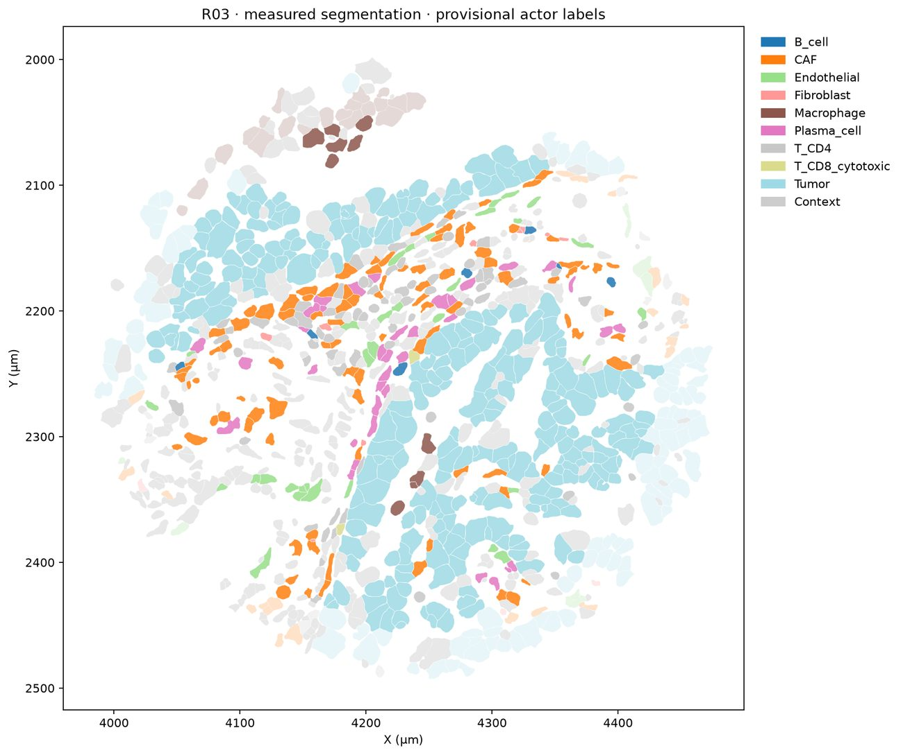

# Part 2 · The input bundle

**Notebook:** `Part2-4_Run_Jev_Simulation.ipynb`, section **PART 2**
**Command line:** `vtx check BUNDLE.zip`
**Engine functions:** `simulation_workflow.extract_bundle`, `prepared_runtime.load_inputs`

The simulator has **one input: a bundle ZIP** for one region, named `simulation_input_<REGION>_<HHMMSS_ffffff>.zip` (≈ 20 MB). This guide explains where bundles come from, what they contain, and how they are checked.

---

## 1. Where a bundle comes from

| Source | How | Notes |
|---|---|---|
| **Part 1 on the public example** | Step 8 of `Part1_Prepare_Xenium_Region.ipynb`, or `vtx prepare … --region R03` | Written to `OUTPUT_BASE/run_<timestamp>/` |
| **Part 1 on your own Xenium run** | Same, after creating a data folder and a cluster annotation map ([06](06_your_own_xenium_data.md)) | The only supported way to build a bundle from new data |
| **Someone else's bundle** | Receive the ZIP and use it unchanged | Every file is protected by the manifest. The runtime must match your engine version |
| **A published example** | Set `INPUT_SOURCE = url` and paste the link, e.g. a GitHub release asset | Maintainers can attach `simulation_input_R03_….zip` to a release so users can skip Part 1 |

> **Why not build the files by hand?** The simulator verifies the SHA-256 of every file, the atlas fingerprint, the contract fingerprint, the identity joins between the atlas and the AnnData, coordinates, areas, contacts and score ranges. A hand-edited bundle is rejected. To change a region, its annotation or its scores, go back to Part 1.

## 2. Giving the bundle to the notebook (✏️ Part 2 cell)

| `INPUT_SOURCE` | Set | Behaviour |
|---|---|---|
| `google_drive` (default) | `BUNDLE_ZIP` = path to the ZIP, **or** to a folder | A folder (for example the Part 1 `run_…` folder or `Xenium_Lung5K_Prepared`) is searched recursively and the **newest** `simulation_input_*.zip` is used. The chosen file is printed |
| `upload` | — | A file chooser appears; select the ZIP on your computer |
| `url` | `BUNDLE_URL` = `https://…/simulation_input_….zip` | Downloaded once into the session |

The ZIP is copied to the session disk (`/content/Xenium_Jev/inputs/`) and extracted into a new, empty folder under `/content/Xenium_Jev/extracted/`. **Keep it compressed. Never upload a folder.**

## 3. What is checked before anything runs

`extract_bundle` refuses the input if any of these fails:

1. **Safe ZIP:** no absolute paths, `..`, backslashes, symbolic links or duplicates; ≤ 500 entries and ≤ 1 GB uncompressed.
2. **Manifest:** exactly one `BUNDLE_MANIFEST.json`. Every listed file exists with the stated size and SHA-256, and no unlisted file is present.
3. **Same runtime:** every `.py` file in the bundle (`prepared_runtime.py`, `xenium_runtime/**`) must be byte-identical to the engine of the package you are running. **The bundle's Python is never imported or executed.** It is kept as a record of the runtime that prepared it.
4. **Atlas and contract:** the atlas fingerprint matches its content, and the contract's fingerprint matches the one recorded in the atlas.
5. **Joins:** ≤ 1,000 cells, unique IDs, AnnData `obs_names` in the same order as the atlas, identical internal IDs, identical XY.
6. **Geometry and evidence:** valid non-empty polygons whose area matches `area_um2`; no contact points to a cell outside the bundle; every acting cell has an identity; every AUCell value and percentile lies in [0, 1].

Then the notebook shows the composition, the file table and a map of the **measured** t0 segmentation, with actors coloured by provisional type and context in grey. No API call is made.



---

## 4. Contents of a bundle

```text
simulation_input_R03_180834_343907/
├── BUNDLE_MANIFEST.json          SHA-256 + size of every other file (format xenium-aucell-bundle-1)
├── START_HERE.txt                short human description
├── atlas.json.gz                 ◀ the cells the simulator uses (see §5)
├── runtime_contract.json         ◀ actions, gates, scenarios, all numerical assumptions (see §6)
├── region.h5ad                   raw counts + XY + AUCell for the same cells (see §7)
├── cells.csv                     the AnnData obs table as CSV
├── geometry.parquet              cell_id, external_cell_id, original_wkb, simulation_wkb, repaired
├── cell_boundaries.parquet       original 10x cell polygons of these cells (vertex table)
├── nucleus_boundaries.parquet    original 10x nucleus polygons of these cells
├── compatibility_report.json     result of the static 10-minute initialisation test
├── annotation_review.csv         cluster interpretation used
├── signature_coverage.csv        genes of each signature present in the panel
├── aucell_provenance.json        AUCell implementation, n_up, universe, tie/zero policies
├── score_calibration.json        per-type reference quantiles from the whole section
├── input_audit.json              raw-file SHA-256s, QC parameters, excluded feature types
├── geometry_audit.json           polygon repairs in the whole section
├── region_selection_rules.json   composition criteria used for proposals
├── SOURCE.json, DOWNLOAD_MANIFEST.json   provenance of the raw data
├── runtime_origin.json           which prototype modules the runtime was adapted from, and how
├── requirements-colab.txt        exact package versions
├── prepared_runtime.py           loader (record only; never executed by the simulator)
└── xenium_runtime/               kernel source (record only; must equal the engine's copy)
```

## 5. `atlas.json.gz`: one record per cell

Gzipped JSON. Top-level keys: `schema_version` (`1.0.0`), `preparation_schema` (`xenium-aucell-input-1.0.0`), `patch_id` (e.g. `Xenium_Prime_Human_Lung_Cancer_FFPE_R03`), `cells`, `geometry` (centre, radius, halo, ROI bounds in µm), `summary` (counts by role and composition), `provenance` (sample, input hashes, annotation fingerprint, `tumor_mode`, contact definition, contract fingerprint), `signatures` (the 20 names with method and `n_up`) and `fingerprint` (SHA-256 of everything else).

Each element of `cells`:

| Field | Example (cell 11869 of R03) | Meaning |
|---|---|---|
| `cell_id` | `11869` | Internal integer ID (reversible; sorted original IDs) |
| `external_cell_id` | `"ajnleafc-1"` | Original Xenium cell ID |
| `role` | `"roi"` | `roi` = acting cell · `occluded` = context inside the region · `halo` = 30 µm context ring |
| `geometry` | GeoJSON Polygon/MultiPolygon | Simplified 10x outline in µm (repaired if invalid) |
| `area_um2`, `x`, `y` | `185.7`, `4113.3`, `2107.0` | Polygon area and original centroid (µm) |
| `polygon_repaired` | `false` | Whether `make_valid` was needed |
| `identity` | `{"candidates":[{"label":"Tumor","lineage":"tumor_candidate","source":"provisional_vendor_cluster_interpretation"}],"agreement":"provisional_single_source"}` | Runtime identity; `null` for context |
| `annotation` | provisional type, compartment, vendor cluster, status, `context_reasons`, `tumor_mode` | Why the cell acts or not |
| `signatures` | `{"GOBP_MITOTIC_CELL_CYCLE": {"method":"AUCell","raw":0.097,"percentile_within_type":…,"percentile_within_type_depth":0.84,"panel_coverage":…}}` | Only signatures with a valid reference; missing ones are absent, never zero |
| `contacts` | `[{"cell_id":11871,"gap_um":0.027,"interface_um":9.17,"outside_patch":false,"occluded":false}, …]` | Neighbours whose polygons are ≤ 1 µm apart (geometric proximity, not proven binding) |
| `neighbour_ids_30um` | `[…]` | Centroids within 30 µm |
| `genes_detected` | 548 symbols | Genes with ≥ 1 count in this cell (kept for audit; **not sent to Jev**) |
| `panel_genes` | 5,001 symbols | The assayed panel |
| `qc` | `{"qc_pass":true,"scored":true,"n_genes_by_counts":548,"transcript_counts":814,…}` | RNA QC of the cell |
| `region` | `{"region_id":"R03","geometric_core":true}` | Region membership |
| `observation_provenance` | text | How the t0 evidence was produced |

What Jev sees from this record: the primary label, the 20 t0 AUCell percentiles and raw values, the provenance sentence, and later the simulated state, fields and contacts. The full question format is shown in [03](03_part3_run_simulation.md#what-jev-receives).

## 6. `runtime_contract.json`: the rules and assumptions

| Section | What it fixes |
|---|---|
| `handler_actions`, `assumed_competence_profiles` | The 26 implemented actions and which may be offered |
| `autonomous_scenarios` | `static` (sanity control) and `S0` (exploratory). Part 3 derives `baseline_unknown`, `declared_recognition` and `recognition_off` from S0 |
| `scheduler` | Minimum interval between questions per type (CD8 60 min, 30 min in tumour contact; CD4/macrophage 180; endothelium 360; tumour/fibroblast 720), at most 24 per cell per day |
| `division` | Accelerated 24 h tumour cycle; crowding limits (cycle entry ≤ 0.25 local pressure; division blocked > 0.4) |
| `biology`, `fields`, `migration`, `mechanics` | Damage per hit (1 AU, death at 2 AU), clearance capacity (4), find-me radius (120 µm), sensing radius (60 µm), field parameters, speeds, area floors |
| `calibration` | **Recomputed for each new sample:** nuclear/cell area ratios per type that set compression floors |
| `provider` | Pinned model, ≤ 20 questions and ≤ 40,000 bytes per request, response size cap |
| `run` | Frame interval (20 min), maximum horizon (7 days) |

Part 3 never edits this file. Your settings are written to `effective_contract.json` in the run folder, next to the original fingerprint.

## 7. `region.h5ad`: the same cells for your own analyses

| Slot | Content |
|---|---|
| `X` | Original, unnormalised Xenium gene counts (Gene Expression features only), sparse |
| `var` | Index `gene_symbol`, column `gene_id` |
| `obs` | Original `cells.parquet` columns plus `n_genes_by_counts`, `qc_pass`, `vendor_cluster`, `internal_id`, `cell_type_provisional`, `compartment`, `runtime_label`, marker counts, `mixed_marker_flag`, `aucell_available`, `score_depth_decile`, `simulation_role`, `simulation_label`, `context_reasons`, `in_geometric_core`, `tumor_mode` |
| `obsm['spatial']` | XY centroids in µm |
| `obsm['AUCell']`, `obsm['AUCell_pct_within_type']`, `obsm['AUCell_pct_within_type_depth']` | DataFrames, one column per signature; NaN = unavailable |
| `uns['preparation']` | Version, sample, region, units, semantics of `X`, `tumor_mode`, signatures, `aucell_n_up`, atlas fingerprint |

```python
import anndata as ad
region = ad.read_h5ad("simulation_input_R03_…/region.h5ad")
region.obsm["AUCell_pct_within_type_depth"].groupby(region.obs.simulation_label).median()
```

---

## 8. Checking a bundle without the notebook

```bash
vtx check simulation_input_R03_180834_343907.zip --scenario baseline_unknown --hours 24
```

This extracts and verifies the bundle, runs one static step and writes `vtx_check/preflight/preflight.json` and `first_request_preview.json`, the exact first request Jev would receive. Typical output for R03:

```json
{"total_cells": 989, "acting_cells": 526, "context_cells": 463,
 "acting_composition": {"Tumor": 263, "CAF": 95, "T_CD4": 71, "Plasma_cell": 36, "Endothelial": 33,
                        "Macrophage": 10, "Fibroblast": 9, "B_cell": 7, "T_CD8_cytotoxic": 2},
 "initial_cell_questions": 280, "initial_http_batches": 26, "growth_headroom": 11, "static_preflight_passed": true}
```

In Python:

```python
import virtualtissue_xenium as vtx
bundle = vtx.workflow.extract_bundle("simulation_input_R03_….zip", "work/extracted")
bundle["atlas"]["summary"], bundle["contract"]["scheduler"], bundle["data"]   # atlas dict, contract dict, AnnData
```
