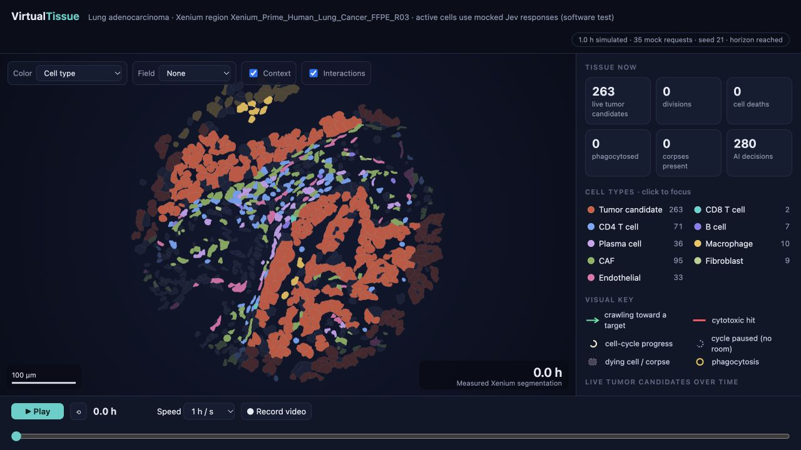
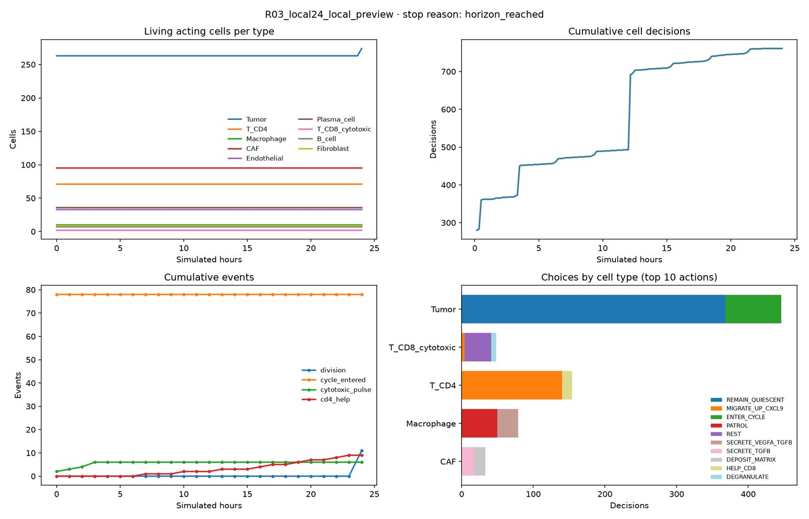

# Part 4 · Results and the replay viewer

**Notebooks:** section **PART 4** of `Part2-4_Run_Jev_Simulation.ipynb` (right after a run), and
`Part4_Explore_Saved_Results.ipynb` (any time later, without the API)
**Command line:** `vtx explore RESULTS.zip --plot overview.png --open`
**Python:** `virtualtissue_xenium.results`

---

## 1. Where the results are

| Location | Content |
|---|---|
| `/content/Xenium_Jev/results/<RUN_NAME>/` | The run folder on the Colab session disk (temporary) |
| `/content/Xenium_Jev/results/<RUN_NAME>_results.zip` | Everything in the run folder, zipped |
| `MyDrive/VirtualTissue/Simulation_Results/<RUN_NAME>/` and `…_results.zip` | Copy in your Drive when `SAVE_RESULTS_TO_DRIVE` is on, refreshed every simulated hour and at the end |
| Your computer | The ZIP, if `DOWNLOAD_RESULTS` is checked in the last cell |
| `/content/Xenium_Jev/results/preflight/<RUN_NAME>/` | `preflight.json`, `first_request_preview.json`, `measured_t0.png` |

Locally (`vtx run` or Jupyter), the same structure lives under the results folder you chose (`vtx_session/results/` in the notebooks).

## 2. Files in a run folder

| File | What it is |
|---|---|
| **`replay.html`** | Self-contained interactive viewer (≈ 0.3–10 MB). Opens offline in Chrome, Firefox, Edge or Safari, with no key and no network |
| `run_report.json` | `completed`, `stop_reason`, `error`, `provider_error`, `checkpoint_time_min`, `usage` (`http_attempts`, `reused_batches`, `input_tokens`, `output_tokens`), episode `summary` |
| `episode.json.gz` | The complete trajectory: `frames` (every 20 simulated min: ids, x, y, size, state of each body, fields), `bodies` (id, label, origin `roi`/`halo`/`occluded`/`born`, parent, birth time, fate), `decisions`, `events`, `metrics`, `summary`, fingerprints |
| `decisions.csv` | One row per cell question: `time_min`, `cell_id`, `provider`, `wake_reasons`, `observation` (what was sent), `options` (the menu, with gates), `answer` (choice, probabilities, confidence), `status` |
| `events.csv` | `time_min`, `kind`, `cell_id`, … for `division`, `cycle_entered`, `cytotoxic_pulse`, `apoptosis_committed`, `intact_death`, `clearance`, `corpse_degraded`, `program_started/completed`, `target_reached`, `division_blocked_crowding`, `growth_blocked_compression`, `exhaustion_transition`, `hypoxic_necrosis`, … |
| `metrics.csv` | Every 10 simulated min: `tumour_cells`, `tumour_area_um2`, `kills`, `born`, `decisions`, `cd8_tumour_contacts`, `cd8_within_20um_of_tumour`, `oxygen_tumour_mean`, `hypoxic_tumour_fraction`, `pressure_mean/max`, `pressure_by_label`, … (dict columns are JSON) |
| `jev_journal.jsonl` | Hash-chained log of every request intent and result. Used to resume. The key is never present |
| `effective_contract.json` | The contract actually used (scenario, horizon, population ceiling, model) |
| `run_config.json` | Configuration fingerprint: bundle SHA-256, settings, engine source hashes, Python and package versions |
| `input_*.json` | Provenance copied from the bundle (`SOURCE`, `aucell_provenance`, `BUNDLE_MANIFEST`, `region_selection_rules`, `score_calibration`) |
| `OUTPUT_MANIFEST.json` | SHA-256 of every output file |
| `overview.png` | Written by the notebook's summary cell |

The input bundle is **not** copied into the results. Keep it to reproduce the run.

---

## 3. The replay viewer



| Control | What it does |
|---|---|
| **Play / pause** (or the space bar), **restart**, the **time slider**, **speed** (0.5–4 simulated h per second) | Navigate in time. The view starts from the **measured** segmentation and cross-fades into the simulated cells within the first 20 min |
| **Color** | `Cell type` (default) · `Current action` · `AUCell score at t0` (then pick a signature, e.g. mitotic cell cycle) |
| **Signals** | Visible buttons for Auto, Off, IFN-γ-like, CXCL9/10-like, oxygen and TGF-β-like. Auto prioritises detectable IFN-γ, CXCL9/10, then TGF-β; otherwise oxygen. A dot marks a nonzero saved field. |
| **Highlights** | Up to three arrow callouts and clickable cards for recorded recent events and local signal maxima. A peak is not a statistical or biological anomaly. |
| **Context** | Show or hide the grey context cells |
| **Interactions** | Arrows (crawling toward a target), red flashes (cytotoxic hits), cycle rings (dashed when paused for lack of space), bursts (division), grey shrinking corpses, gold flashes (phagocytosis) |
| Mouse wheel / drag / double-click | Zoom, pan, fit to view |
| Hover a cell | Tooltip with type and current state |
| **Click a cell** | **Inspector:** its t0 AUCell percentiles as bars, its lineage, and every decision it made, with the menu and Jev's probabilities |
| Legend (cell types) | Click a type to hide or show it |
| Right panel | Live counters (tumour candidates, divisions, deaths, phagocytosed, corpses, AI decisions), a tumour-count chart and a recent-events feed |
| **● Record video** | Records the canvas as a `.webm` file while it plays |

In Colab the replay is shown in an `iframe` inside the notebook. For the smoothest experience, open `replay.html` from the downloaded ZIP or from Drive (*Download* first; Drive's preview does not run it).

---

## 4. Explore saved results later (`Part4_Explore_Saved_Results.ipynb`)

This notebook needs no API key and does not install the simulation stack. It only uses pandas and matplotlib, which Colab already has.

| Cell | ✏️ | Shows |
|---|---|---|
| Setup | `CODE_SOURCE` | — |
| Result to open | `RESULTS_SOURCE`, **`RESULTS_PATH`** (ZIP or folder in Drive) | Headline table |
| Interactive replay | — | `replay.html` inline |
| Overview | — | Four panels (living acting cells per type, cumulative decisions, cumulative events, choices by type); first/last population; choice × type table; events per 6 h |
| One cell | **`CELL_ID`** (0 = the first cell that decided) | Every decision of that cell, with the full probability distribution and its wake reasons |
| Compare runs | **`COMPARE_PATHS`** (comma-separated) | One row per run: mode, scenario, stop reason, hours, decisions, requests, tokens, tumour cells, divisions, deaths, clearance |



*`plot_overview` for a 24 h **local preview** of R03 under `declared_recognition` (programmed rules, not Jev). 78 tumour cells entered the cycle at t0, but only 11 could divide: the default population ceiling of 1,000 bodies leaves 11 free slots.*

## 5. Python API

```python
from virtualtissue_xenium import results as R

res = R.load_results("R03_jev_run01_results.zip")     # or the run folder
R.summary(res)                 # dict: mode, scenario, stop_reason, simulated_hours, cell_decisions, http_attempts, tokens, …
R.population_by_type(res)      # DataFrame: living acting cells per type at every frame (index = simulated hours)
R.decision_table(res)          # one row per decision: hours, cell_id, cell_type, choice, target_id, probability, confidence
R.choice_counts(res)           # cell type × chosen action
R.cell_history(res, 11869)     # every decision of one cell with all probabilities
R.event_counts(res, bin_hours=1)
fig = R.plot_overview(res); fig.savefig("overview.png", dpi=150)
R.compare_runs(["runA_results.zip", "runB_results.zip", "runC_results.zip"])
```

`res` also gives direct access to `res["episode"]` (the full trajectory dict), `res["metrics"]`, `res["events"]`, `res["decisions"]` (pandas DataFrames), `res["report"]` and `res["replay"]` (path).

**Example: how did tumour cells with a high mitotic score decide?**

```python
import pandas as pd
d = R.decision_table(res)
tumour = d[d.cell_type == "Tumor"].copy()
# t0 percentile of each asked cell, taken from what was actually sent (missing evidence stays missing)
mitotic = {x["cell_id"]: (x["observation"].get("t0_aucell_percentile") or {}).get("MITOTIC_CELL_CYCLE")
           for x in res["episode"]["decisions"]}
tumour["mitotic_pct"] = tumour.cell_id.map(mitotic)
tumour.groupby(pd.cut(tumour.mitotic_pct, [0, .25, .5, .75, 1]), observed=False).choice.value_counts(normalize=True).unstack()
```

## 6. Interpreting results

* Probabilities are Jev's **preferences among the options offered at that moment**. They are not rates, and they change when the menu changes. Always read them together with `options` and `excluded`.
* A count such as "tumour cells at 24 h" depends on declared assumptions: the accelerated 24 h cycle, damage per hit, the population ceiling and the scenario. Compare runs that differ in **one** setting (e.g. `declared_recognition` vs `recognition_off`, same seed) rather than reading absolute numbers.
* Local-preview results are labelled `local…` in `provider` and in the folder name. Never mix them with Jev runs without saying so.

## Reading highlights and fields

Arrow labels and clickable cards show up to three recent recorded events (within 40 simulated minutes) and local secretion-field peaks at the current saved frame. A local maximum is not a biological anomaly. Field values reconstructed from the replay are approximate (8-bit display encoding); the scale is fixed across each run and may differ between runs. Use common scales for quantitative comparisons. Zero-field frames are explicitly labelled. TNF-alpha is not implemented.

The scenario banner explains when CD8 killing is disabled. The cumulative death tile counts apoptosis commitments plus hypoxic necrosis, without recounting completion of apoptosis. Playback controls display existing results; they do not launch an intervention or call Jev.
