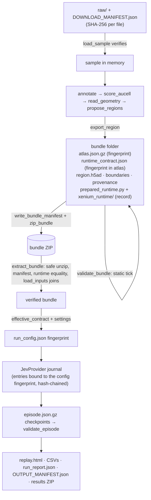

# Architecture and maintenance

## 1. Design goals

1. **Keep the validated code exactly as it is.** The engine (Part 1 preparation, kernel, Jev client, replay) was developed and validated before this repository existed. The repository organises it into an installable package, adds documentation, notebooks and helpers, and **does not change a single byte** of it.
2. **One engine for all parts.** Bundles made by Part 1 must be accepted by Parts 2–4, so both sides share one folder.
3. **Users bring their own data, Drive and API key.** Nothing personal lives in the repository.

## 2. Package layout

```text
src/virtualtissue_xenium/
├── __init__.py          stdlib only · ENGINE_DIR · activate_engine() · lazy vtx.prepare / vtx.workflow / vtx.runtime
├── engine/              ◀ VERBATIM (32 files, hashes in ORIGINAL_SOURCES.json)
├── download.py          new · public example download (HTTP ranges), verification, manual registration
├── own_data.py          new · data folder + manifest for your Xenium run, cluster-map template/validation/activation
├── colab.py             new · Colab detection, Drive mount, key lookup, run backup/restore, inline replay
├── results.py           new · Part 4 analysis helpers
├── cli.py, __main__.py  new · `vtx` command line
└── datasets/xenium_prime_lung5k/   new · metadata of the public example (SOURCE, DOWNLOAD_MANIFEST, checksums)
```

### Engine module map

| File (unchanged) | Version string | Role |
|---|---|---|
| `xenium_prepare.py` | `lung5k-preparation-1.1.0` | Part 1: `load_sample`, `annotate`, `score_aucell`, `read_geometry`, `propose_regions`, `plot_*`, `manual_region`, `export_region`, `write_bundle_manifest`, `zip_bundle` |
| `prepared_runtime.py` | — | `load_inputs` (all integrity checks), `initialize`, `validate_bundle` (static tick). **Copied into every bundle** |
| `simulation_workflow.py` | `xenium-jev-colab-1.1.0` | `extract_bundle`, `effective_contract`, `preflight`, `run` (lock, config binding, checkpoints, tables, replay, results ZIP) |
| `jev_provider.py` | `jev_choice_journal_v1` | `JevProvider`: batching, hard request cap, hash-chained journal, response validation, no retries/redirects |
| `player.py` + `web/player_template.html` | — | Builds the single-file offline replay |
| `xenium_runtime/` | runtime 0.2.1 / v2 | Kernel: `v2/autonomous.py` (simulation loop, decisions, programs), `mechanics.py`, `geometry.py`, `fields.py`, `menus.py`, `scheduler.py`, `policy.py` (local preview), `provider_jev.py` (payload/batching), `episode.py` (validation), `fidelity.py`. **Copied into every bundle** |
| `resources/` | — | `cluster_annotations.json` (public sample), `go20_msigdb_2026.1.Hs.json`, `runtime_template.json`, `runtime_origin.json`, `gene_sets_provenance.json` |
| `colab_setup.py`, `colab_setup_prepare.py` | — | Python 3.12/3.13 check, pinned install, restart detection (simulation / preparation variants) |
| `requirements-colab.txt` | — | Exact versions. Copied into every bundle; identical to the pyproject pins |

`colab_setup_prepare.py` is the original `Xenium_Public_Lung5K/processing/colab_setup.py`. It was renamed only because the simulation folder had a different file with the same name. Its content is unchanged.

`.gitattributes` disables line-ending conversion for `engine/**`, so Git checkouts preserve the recorded bytes on every platform. Keep this rule when publishing or cloning; even a line-ending change would invalidate the original hashes.

## 3. Why the engine is on `sys.path` instead of being a sub-package

The engine modules import each other by top-level names (`from xenium_runtime.io import fingerprint`, `from prepared_runtime import load_inputs`, `from player import write_player`). Converting them to relative imports would change their bytes, and that would break the integrity chain:

```text
Part 1  export_region()  copies ENGINE/prepared_runtime.py and ENGINE/xenium_runtime/** into the bundle
                         and lists their SHA-256 in BUNDLE_MANIFEST.json
Part 2  extract_bundle() requires every bundled .py to be byte-identical to SOURCE/<same path>
                         (SOURCE = the folder of simulation_workflow.py = ENGINE)
```

Because `xenium_prepare.ROOT == simulation_workflow.SOURCE == ENGINE_DIR`, bundles made by this package are always accepted by this package. Bundles made earlier by the original notebooks (e.g. `simulation_input_R03_180834_343907.zip`) are accepted too, because the runtime files are identical. A test asserts this.

The cost is that the module names `xenium_prepare`, `simulation_workflow`, `prepared_runtime`, `jev_provider`, `player`, `colab_setup`, `colab_setup_prepare` and `xenium_runtime` become importable at top level once `virtualtissue_xenium` is imported. `check_engine_origin()` detects a conflicting copy.

## 4. Data flow and integrity chain



## 5. Notebooks are generated

`notebooks/*.ipynb` are produced by [`tools/build_notebooks.py`](../tools/build_notebooks.py). Edit that file, then:

```bash
python tools/build_notebooks.py
pytest tests/test_colab_setup.py
python tests/run_notebooks_mocked.py --output /tmp/nb --bundle path/to/bundle.zip   # or --data-dir for Part 1 too
```

The analysis cells are copies of the validated cells of the original notebooks (*Xenium_Lung5K_Prepare_AUCell.ipynb* v1.1 and *Xenium_Lung5K_Run_Jev_NoDrive.ipynb* v1.1). The new parts are the setup cell (GitHub/Drive code source instead of embedded base64 code), the Drive paths and optional download in Part 1, the explicit `REGION_TO_EXPORT` parameter, the Drive/upload/URL input choice and the Drive backup/restore in Parts 2–4, the bundle inspection cell, the summary figures, and the explorer notebook.

Commit notebooks **without outputs**. The builder writes them empty.

## 6. Changing the engine (maintainers)

Engine changes are possible but deliberate:

1. Edit the file in `src/virtualtissue_xenium/engine/` and bump the version string inside it (`VERSION` in `xenium_prepare.py` / `simulation_workflow.py`, and the matching check in the corresponding `colab_setup*.py`).
2. Regenerate `ORIGINAL_SOURCES.json`: record the new hashes and describe the change. `test_engine_integrity.py` fails until you do.
3. Know the consequences:
   * any change to `prepared_runtime.py` or `xenium_runtime/**` makes **all existing bundles incompatible**. They must be re-exported with Part 1;
   * any change to an engine `.py`, `.html` or `.txt` changes the run-configuration fingerprint, so **runs started before cannot be resumed**;
   * changing `requirements-colab.txt` also requires the same change in `pyproject.toml` (test enforced) and invalidates resumes.
4. Bump the package version in `pyproject.toml` and `__init__.py`, and add an entry to `CHANGELOG.md`.

## 7. Origin of the code

| Repository folder | Came from (Helder's working folders, 25 Oct 2026) |
|---|---|
| `engine/xenium_prepare.py`, `engine/resources/`, `engine/colab_setup_prepare.py` | `Xenium_Public_Lung5K/processing/` (notebook *Xenium_Lung5K_Prepare_AUCell* v1.1) |
| `engine/simulation_workflow.py`, `jev_provider.py`, `player.py`, `web/`, `colab_setup.py` | `Colab_Xenium_Jev/source/` (notebook *Xenium_Lung5K_Run_Jev_NoDrive* v1.1) |
| `engine/prepared_runtime.py`, `engine/xenium_runtime/`, `engine/requirements-colab.txt` | identical in both folders |
| `datasets/xenium_prime_lung5k/` | `Xenium_Public_Lung5K/` (SOURCE, DOWNLOAD_MANIFEST, CHECKSUMS, VALIDATION) |
| `tests/test_provider.py`, `tests/test_preparation.py`, `tests/validate_r03.py` | original tests, unchanged |
| `tests/test_colab_setup.py`, `tests/run_notebooks_mocked.py` | adapted from the original tests |

`xenium_runtime` is itself an isolated adaptation of the LUAD3 prototype runtime (`luad_tissue`, *Colab_Prototype*); `resources/runtime_origin.json` lists the original module hashes and every modification (AUCell instead of UCell, no network transport inside the runtime, population cap 1,000, etc.).

## 8. Publishing the repository (maintainers)

```bash
cd VirtualTissue-Xenium
git init -b main
git add .
git commit -m "VirtualTissue-Xenium 0.1.0"
git remote add origin https://github.com/hylixinsights/VirtualTissue-Xenium.git
git push -u origin main
```

* `.gitignore` already excludes data, bundles, results, journals and secrets. Run `git status` before the first commit and check that no `.h5ad`, `.parquet`, `.zip` or key file is staged.
* Optional: create a GitHub **release** and attach an example bundle, e.g. `simulation_input_R03_180834_343907.zip` (≈ 20 MB, derived from CC BY 4.0 data; keep the 10x attribution in the release notes). Users can then skip Part 1 with `INPUT_SOURCE = url`.
* After publishing, the "Open in Colab" badges in `notebooks/README.md` and the default `CODE_SOURCE = github` work without changes.
