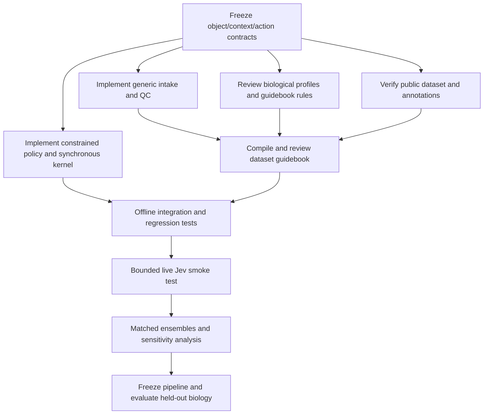

# Validation plan for a context-aware virtual tissue

This plan separates software correctness, scientific plausibility and predictive validation. Passing one level does not imply passing the next. Numerical thresholds below are proposed acceptance criteria to agree before a biological validation study; they are not measured performance claims.

## 1. Freeze the claim before selecting the benchmark

The initial claim is: an annotated expression object plus an explicit context can initialize an auditable, constrained, context-dependent agent simulation. Outputs are hypothetical trajectories conditional on the declared guidebook and mechanisms. Jev scores and guidebook weights are operational decision weights until independently calibrated.

Do not claim that a single baseline Xenium section identifies patient response, actual transition rates, future expression, antigen recognition or a complete three-dimensional tissue. A public static brain or skin dataset validates intake and initialization, not treatment efficacy.

## 2. Software release gates

| Gate | Required check | Pass condition |
|---|---|---|
| Object contract | Sparse/dense expression; unique cell and gene IDs; annotation mapping; finite nonnegative counts; spatial dimensions and units; absent coordinates | Valid cases produce the same canonical representation; invalid or ambiguous cases fail with actionable errors |
| Context contract | Tissue, species, disease, assay, sampling/enrichment, perturbations and explicit unknowns | Missing required fields and unsupported enum values fail; free text never creates executable actions |
| Measurement provenance | Counts versus transformed expression, source layer, gene namespace, panel, coordinate source and object hash | Every guidebook records the exact evidence source and missingness |
| Cell/action restrictions | Neurons, epithelial cells, immune cells, unknown labels; explicit cancer identity; recognition off | No forbidden action obtains nonzero executable weight; unknown evidence does not silently become a negative measurement |
| Probability semantics | Prior weights, Jev scores, combined distribution and selection rule | Each valid distribution is finite, nonnegative and normalized; original scores remain auditable |
| Seed reproducibility | Repeat local/mock runs with the same configuration; shuffled cell storage order | Identical trajectories under the documented determinism policy; any intentional order dependence is disclosed |
| Synchronous updates | Multiple decisions and competing interactions in the same tick | All choices use the same pre-update state; tie/conflict rules are explicit and reproducible |
| Clock semantics | Vary tick size while preserving rates or declared per-step units | Either approximately stable outcomes at the chosen tolerance or explicit labeling that weights are step-dependent |
| State integrity | Death, division, daughter IDs, capacity, bounds, signal accumulation/decay | Dead cells do not decide; daughters have valid lineage; capacity is audited; no nonfinite or negative forbidden state |
| Provider isolation | Wrong model, missing answers, extra options, NaN, out-of-range scores, non-JSON, timeout and cap | Fail closed before a partial biological round is committed; no silent local substitution |
| Key handling | Inspect source, results, request journals and error output | No credential appears in persisted outputs; endpoint and model are recorded |
| Audit/resumption | Interrupt before/after request intent and after response; rerun with changed context | No ambiguous request silently repeats; changed configuration cannot reuse incompatible responses |
| Results | Completion status, missing data, hypothetical geometry, inferred states and computational limits | All are visible in machine-readable metadata and user-facing reports |
| Installation | Fresh documented Python environment and packaged wheel | Import, CLI help and the offline example work from the installed package |

Use small fixtures to exercise dangerous invariants and actual integration behavior. Avoid tests that merely reproduce the implementation's arithmetic in another function. Preserve the v0.1.3 regression suite while adding v2 tests.

## 3. Guidebook review before paid inference

For each cell type and action, reviewers should inspect:

1. The measured evidence: assay/panel coverage, detected markers, signatures, annotation confidence, reference population and sample count.
2. The permission rule: what is structurally prohibited, what requires an explicit assumption, and what is only down-weighted.
3. The prior: its numerical value, units or decision interval, provenance and rationale. A hand-set value must say so.
4. Context modifiers: tissue, disease, perturbation, target, schedule, sampling and evidence level. A desired outcome must not appear as a rule.
5. Missingness: absent-from-panel, measured zero, insufficient RNA and absent protein evidence remain distinguishable where available.
6. Consequences: a choice maps to an implemented transition and declared duration/rate, rather than an unconstrained model narrative.

A guidebook should be reviewable without an API key. Its hash and version must accompany every run. Changes to a guidebook require new provenance even if the expression object is identical.

## 4. Public-data demonstration

Select one public Xenium brain or skin study with accessible count matrices, spatial coordinates, panel information and usable cell annotations. Record the primary study, accession, specimen/condition, license and download checksums. If annotations are absent, document their derivation and human review as a separate task; do not describe vendor clusters as validated cell types.

Run these steps in order:

1. Download and verify the original files. Keep an immutable raw-data directory.
2. Import the sparse expression object and preserve original cell IDs. Confirm count-to-metadata joins by ID.
3. Audit annotation quality, segmentation, counts, panel coverage and spatial units; export a compact QC report.
4. Select a reproducible region with stated spatial and composition criteria, without lung-tumour requirements.
5. Create the explicit baseline context and a draft guidebook. List supported and passive/context-only types.
6. Run a short local/mock simulation to validate serialization, restrictions, synchronous updates and outputs.
7. Run a bounded live Jev smoke test and inspect every request/response and the output distribution.
8. Run matched hypothetical perturbation and control arms only after the mechanism assumptions are reviewed.

A healthy static brain section can support a simulated inflammatory perturbation example, but it supplies no observed inflammatory outcome against which to validate that perturbation.

## 5. Controls and ablations

| Experiment | What it tests | Interpretation |
|---|---|---|
| No-op/sham perturbation | Pipeline identity and context consistency | Sham and baseline agree under fixed deterministic conditions |
| Local policy versus Jev on the same permitted menus | Added value of remote decision ranking | Differences are policy effects; neither policy is biological ground truth |
| Guidebook-only versus Jev-only weighting versus combined policy | Dependence on manually chosen priors | Strong dependence on arbitrary priors is reported as sensitivity |
| Recognition disabled | Dependence of cytotoxicity on a necessary declared assumption | No recognized-target attack is permitted |
| Target absent or incompatible cell type | Target/mechanism restrictions | Treatment label alone does not create efficacy |
| Tissue/context swapped with the same object | Prompt-induced prior effects | A large effect needs explanation and independent evidence |
| Annotation uncertainty and unknown labels | Robustness to identity ambiguity | Impossible lineage behavior remains blocked |
| Reduced gene panel / masked evidence | Dependence on assay coverage | Missing evidence increases uncertainty instead of becoming evidence of absence |
| Enriched versus representative sampling declaration | Appropriate interpretation of composition | Enriched inputs do not yield whole-tissue frequency claims |
| Nonspatial nuclei input | Explicit geometry assumptions | Outputs say that contacts/locations are hypothetical or use a declared nonspatial model |
| Interaction graph shuffled / signaling removed | Whether spatial interactions drive the observed pattern | Loss or persistence of an effect is quantified |
| Capacity, boundary, radius, tick and rate sweeps | Numerical and structural sensitivity | Ceiling/boundary-driven effects are separated from biological hypotheses |

Do not require cancer to grow, chronic disease to exhaust, or anti-PD1 to kill as a software acceptance condition. That would validate a desired result that was encoded by construction.

## 6. Predictive validation requires additional data

Use a study with baseline and observed post-perturbation measurements, ideally randomized treatment/control, multiple independent donors and orthogonal functional readouts. Hold out donors, sections and studies; holding out neighboring cells alone leaks shared specimen information. If guidebook values are tuned, use training donors, choose models with validation donors, and freeze the entire pipeline before the final test set.

Recommended endpoints depend on the perturbation and the observation assay:

- Cell-type/state abundance changes with donor-level uncertainty and an explicit account of sampling bias.
- Proliferation and death measured independently, for example by suitable imaging or protein/functional assays, rather than the same RNA signature used to set priors.
- Spatial contact, neighborhood and localization changes when measured in both arms.
- Immune activation/exhaustion state frequencies using predeclared definitions, not a mandatory direction of change.
- Calibration of action/outcome probabilities only where corresponding observed labels, time intervals and denominators exist. Use reliability curves and proper scores such as Brier score or log loss.
- Comparison against simple baselines: no change, guidebook-only, context-only and a suitable statistical or mechanistic model.

Cells within a donor are not independent biological replicates. Report effect sizes, confidence/credible intervals, donor-level sample counts, simulation seed counts, failures and censored runs. More simulation seeds reduce Monte Carlo noise; they do not increase the number of biological replicates.

Repeated static snapshots can support association checks, but they do not alone identify cell-level causal transition probabilities. Treatment enrichment, confounding, assay shifts and differential survival need explicit study-design treatment.

## 7. Parallel and sequential work

After the shared contracts are fixed, intake/QC, biological profile curation, public-data preparation and kernel/provider implementation can proceed in parallel. Guidebook review depends on both the data audit and profile curation. Paid inference follows offline integration checks. Predictive claims follow held-out biological validation.

## 8. Status reporting template

Each release/run report should state software version and git revision, object/context/guidebook hashes, provider/model/prompt versions, selection rule, seed and numerical settings, specimen and sampling scope, coordinate origin, supported cell types/actions, test mode, completion and stop reason, API usage, known missing evidence and validation level.

Use four independent status fields: `software_checks`, `live_api_check`, `public_data_demo`, and `biological_validation`. Record pass/fail/not-run with evidence. Never collapse those into a single validated flag.
