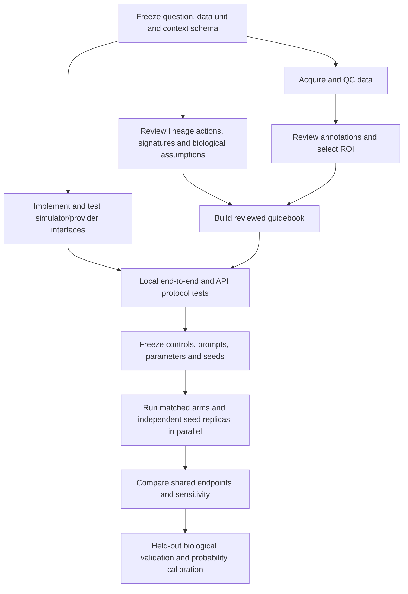

# V2: execution order and collaboration plan

The goal is a reproducible **context-conditioned hypothesis simulator**. An annotated object supplies measured cells and expression. The investigator supplies tissue, disease, sampling and perturbation context. An auditable guidebook constrains decisions. Jev supplies relative preferences over the currently allowed actions. A seeded sampler and deterministic synchronous kernel apply transitions.

Version 2.0.0a1 implements this software path. It does not yet learn calibrated transition probabilities or predict new transcriptomes. Those are separate validation and model-development tasks below.

## Read these first

**For a practical first run with your own dataset, start with [Run your own data](YOUR_DATA.md).** It includes installation from `main`, annotated-object requirements, a full context template and the exact commands.

1. [v0.1.3 review](CODE_REVIEW_V0_1_3.md): what makes sense, what prevents generalization and what v2 changes.
2. [Context and guidebook contract](CONTEXT_AND_GUIDEBOOK.md): exact required input and the meaning of each score.
3. [Public datasets](DATASETS.md): skin melanoma first, WT/Tg brain second, chronic-skin study for subsequent validation.
4. [Validation protocol](VALIDATION_PLAN.md): controls, ablations, held-out donors and biological evaluation.

## Ordered user workflow

| Order | Task | Input | Output / acceptance criterion |
|---|---|---|---|
| 1 | Install v2 | Python 3.12/3.13, repository | `pip install -e '.[xenium,test]'`; JSON-only demo needs only `.[test]` |
| 2 | Select the experiment and measurement unit | Tissue, assay, donor/section, scientific question | A defined population, ROI/subset and contrast; avoid merging donors into a fictitious tissue |
| 3 | Audit expression and annotation | Annotated AnnData or Xenium counts/cells + reviewed CSV | Exact unique cell IDs and gene symbols, nonnegative counts, reviewed lineage mapping, measured XY or explicit well-mixed mode |
| 4 | Declare context | Origin tissue, disease, observed baseline, hypothetical intervention, sampling design, missing populations, timescale | Investigator-reviewed `context.json`; dose/duration are descriptive until a mechanism is implemented |
| 5 | Build the guidebook | Object, context and reviewed species-specific gene sets | `vtx2 prepare` / `prepare-xenium`; panel-aware evidence, assumed weights, full provenance and preparation fingerprint |
| 6 | Review the guidebook | Per-type/per-cell summaries and explicit modifiers | Expert checks incompatible actions, missing signatures, assumptions and missing cell populations; change source context/priors and rebuild, rather than hand-editing checksummed bundles |
| 7 | Preflight and local smoke test | Prepared bundle | `vtx2 inspect`; then `vtx2 run ... --mode local`; check isolation, alive/dead states, limits and replay |
| 8 | Run matched Jev arms | Same measured input, gene sets, runtime, seed, timestep, sampling and horizons | Concurrent bounded Jev calls, complete atomic rounds, durable journal and no hidden fallback; keep all settings and prompts recorded |
| 9 | Compare multiple seeds | Control, prompt-only perturbation, mechanism modifier, modifier-only/local and recognition-off controls | Latest common endpoint via `vtx2 compare`; empirical variability across seeds; report assumption sensitivity |
| 10 | Validate before predictive claims | Independent observed outcomes, ideally pretreatment/perturbation/control and multiple donors | Held-out evaluation, calibration and comparison against simpler baselines; preregister outcomes and avoid validating on the same data used to choose rules |

An input object without reviewed annotations can complete input compatibility checks, but it cannot provide biologically meaningful action roles. Unknown lineages intentionally REST. A Xenium cluster number is not a cell type. Review malignant identity independently; do not equate generic epithelium with cancer.

## Concrete commands

From the repository root, after installation:

```bash
# First understand the complete software path using synthetic data.
vtx2 prepare examples/v2/synthetic_cells.json examples/v2/context_melanoma_control.json outputs/v2/control.json
vtx2 inspect outputs/v2/control.json
vtx2 run outputs/v2/control.json outputs/v2/control --steps 48 --seed 21   # 0.5 h steps, one day

# Then prepare a bounded, annotated real object. Adapt annotation names/layer.
vtx2 prepare annotated_region.h5ad context.json outputs/v2/real.json \
  --cell-type-key cell_type --lineage-key lineage --sample-key donor_section --layer counts
vtx2 inspect outputs/v2/real.json
vtx2 run outputs/v2/real.json outputs/v2/real_local --steps 12 --seed 21

# Only after inspection, provide your key through the environment.
vtx2 run outputs/v2/real.json outputs/v2/real_jev --mode jev \
  --steps 12 --seed 21 --max-http-attempts 700 --workers 2   # see vtx2 cost
```

If counts are in `X`, omit `--layer`. The gene panel comes from all `var_names`, including undetected genes; panel absence remains distinct from an observed zero. `--coordinate-scale` converts measured coordinates to micrometres. No coordinates are inferred for sc/snRNA-seq. For a nonhuman organism, pass `--gene-sets reviewed_species_signatures.json`.

To compare treatment assumptions, copy the context and change only the intervention and explicitly hypothesized rules. Keep measured input, assay, sampling, disease, tissue, graph, scoring and timestep identical. Prepare each arm separately and run the same seeds. `vtx2 compare RUN_CONTROL RUN_PERTURBED` rejects mismatched measurements and key invariant settings. It describes the full context of each arm so an analyst can assess which assumptions changed. It is not a statistical test or causal-effect estimator.

The anti-PD1 template uses a deliberately arbitrary twofold activation preference. Recognition is false until explicitly declared. A CD8 also needs an activated, nonexhausted state and a local live malignant neighbor for KILL. Terminal exhaustion, proliferation and treatment benefit are never guaranteed by a diagnosis or drug name. An activation increase in that modifier experiment is imposed by construction; it is not independent confirmation of treatment action.

For chronic disease, record whether the source sample is already diseased. Map initial exhaustion/activation only when justified, using explicit `initial_state` assumptions or a reviewed Python transformation. Distinguish that observed baseline from any further hypothetical perturbation to avoid counting a disease effect twice.

## Task dependencies and parallel work



| Workstream | Can run in parallel with | Must wait for | Current status |
|---|---|---|---|
| Code review of v0.1.3 | Dataset selection; schema design | Immutable v0.1.3 reference | Completed and documented |
| Public skin/brain acquisition and checksum audit | Guidebook and kernel development | Source/license review | Completed for the specified individual files |
| Annotation and biological role review | Mechanism literature review; software tests | Dataset QC and experiment question | Required for meaningful real-tissue behavior; public smoke tests stay unreviewed |
| Input/context/guidebook implementation | Provider/kernel development after shared interface | Schema/action contract | Implemented and tested |
| Provider concurrency, budgets and synchronous kernel | Signature/annotation review | Shared interface | Implemented and tested |
| Local/API engineering tests | Independent dataset annotation work | Integrated software path | Completed within recorded scope |
| Matched simulations | Different regions and seeds | Frozen annotation, reviewed guidebook, controls and preflight | Runnable; real biological experiments await reviewed labels/assumptions |
| Predictive calibration / held-out validation | Independent cohorts after protocol freeze | Appropriate measured perturbation outcomes | Planned; not completed by these technical demos |

Different seeds/ROIs can run in parallel after definitions are frozen. Within a simulation, cells decide against the same snapshot and Jev batches can execute concurrently. The commit barrier is sequential: do not update one cell before constructing another cell's observation in the same round. Baseline data selection, annotation, guidebook review and simulation interpretation have ordered dependencies even when their preparation work is parallel.

## What must be developed next

| Priority | Task | Deliverable and test |
|---|---|---|
| P0 | Expert annotation for a selected melanoma and brain ROI | Reviewed labels, malignancy evidence, uncertainty and exact cell-ID coverage |
| P0 | Independent perturbation endpoints | Multi-donor/treatment/control measurements with pretreatment context and a held-out split |
| P0 | Transition/rate calibration | Separate event opportunities from elapsed time; estimate rates and uncertainty; validate step-size stability and empirical frequency calibration |
| P1 | Data-supported interaction rules | Reviewed ligand/receptor or spatial-contact evidence, receptor competence, missing-panel handling; compare against abstract-signal baseline |
| P1 | State-memory/duration model | Persistent activation/exhaustion and cell-cycle clocks with evidence-backed kinetics; test pathological synchronous or repeated events |
| P1 | Assay/sampling extensions | snRNA-specific evidence signatures, enrichment sensitivity, externally supplied missing-population models with uncertainty |
| P1 | Comparative evaluation | Guidebook-only, Jev-only, pooled, shuffled-expression, prompt-only and explicit-modifier controls; donor-level metrics and confidence intervals |
| P2 | Dynamic transcriptome prediction | Separate learned state/expression model with actual longitudinal or perturbation training targets; do not manufacture expression changes from free text |
| P2 | Optional physical model | Calibrated mechanics, diffusion, motility and pharmacology behind a defined kernel interface |
| P2 | Broad tissue adapters | Review nasal mucosa, lymph node, melanoma and brain action/state ontologies; keep unknown labels conservative |

The code is deliberately extensible at the input, context, guidebook, decision-provider and kernel boundaries. New actions need an implemented kernel transition and tests, not only a new natural-language action description.

## Validation evidence

- [Code review](CODE_REVIEW_V0_1_3.md) links to immutable source lines in v0.1.3.
- [Data-download validation](DATA_DOWNLOAD_VALIDATION.json): actual files, SHA-256 and 1,000-cell adapter checks.
- [Real-data smoke tests](REAL_DATA_SMOKE_TEST.json): three rounds on 1,000 cells from melanoma, WT brain and Tg brain; unknown roles, REST only, no biological prediction.
- [Live API smoke test](LIVE_API_SMOKE_TEST.json): two rounds on a 24-cell synthetic fixture using pinned Jev; protocol validation only.
- [Software validation report](SOFTWARE_VALIDATION.json): exact automated-check scope and environment limitations for this preview.

Raw data, prepared objects, journals and full results stay in ignored `data/` and `outputs/` folders. The repository contains source manifests and small credential-free validation summaries. Read-only data can be shared under the provider's license; annotations and study-specific context should be reviewed before sharing unpublished measurements with any external decision API.

## Recovery and limits

A run writes `checkpoint.json` (the last fully committed state, for inspection) only after a complete decision round. Resume does not read it: it reconstructs from t0 and reuses successful cached responses. Configuration or guidebook changes require a new run directory. Unknown outcomes are never retried automatically; preserve their journals. Exclusive run locks prevent accidental simultaneous writers. If a process was forcibly terminated, verify it has exited before manually removing its stale lock.

The preview keeps frames and decisions in memory for export, so start with hundreds to 1,000 cells and short horizons. A higher live-cell ceiling permits growth but does not add biological realism. Living-capacity limits, centroid truncation, synthetic daughter offsets, abstract signals and one-action-per-step rules are declared model assumptions. A stable-looking movie is not proof that the tissue dynamics are correct.
